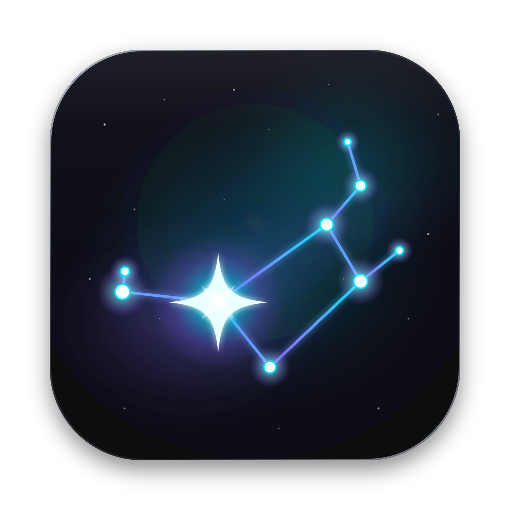

# panel-home · PleyadesHome



**PleyadesHome** es el panel de la casa, de la familia **Astreo** (Santaella), la misma de [OrionGit](../client-git): mismo estilo y paleta,
con las Pléyades (M45) como imagen y Alcyone, la más brillante, como la casa. Al abrirlo, las Pléyades se dibujan
mientras llegan los datos; con tema automático, claro u oscuro (botón ◐), y pensado para usarse también desde el celular.

Una sola web para la casa, con su propia medición: **red** (sonda), **cámaras** (video en vivo, PTZ, grabaciones y detector),
**luces Tuya** por habitación, **rutinas**, **clima**, consumo por dispositivo y una línea de tiempo de eventos con avisos
por Telegram o push. Python 3.9+; la única dependencia externa es `tinytuya` (focos Tuya).

## Qué hace

| Área | Qué tiene |
|---|---|
| Inicio | Portada tipo panel de pared: reloj, notas, cámara, clima, una habitación, lista de habitaciones, accesos directos, agenda y barra de acciones |
| Resumen | Todo junto: cámaras, mapa de la red, caídas, consumo, almacenamiento, movimiento por hora y línea de tiempo |
| Luces | Focos Tuya agrupados por habitación; encender, brillo, blanco o color, y rutinas |
| Capturas | Fotos y clips por día y cámara: ver, borrar y descargar en `.zip` |
| Cámaras | Rejilla de cámaras en vivo, PTZ (ONVIF), zoom digital, alta y baja de cámaras |
| Red | Equipos, alias, escáner de puertos, velocidad, eventos y exportación a CSV |

Diseño: barra lateral, ruta arriba, paneles de vidrio sobre la nebulosa Astreo. Funciona en claro y oscuro.

## Modos: sonda y cámaras internas

panel-home se puede usar en dos modos, cada uno con su interruptor en `.env`:

| Interruptor | `0` (transición) | `1` (nativo) |
|---|---|---|
| `RED_INTERNA` | lee la red de NetWatch por HTTP (`NETWATCH_URL`) | la mide la **sonda** (`sonda/`, fuera de Docker) y la procesa panel-home |
| `CAMARAS_INTERNAS` | lee las cámaras de gestorCamaras por HTTP (`CAMARAS_URL`) | registro, go2rtc interno, video por el panel, PTZ, grabaciones, detector, bot y resumen |

Mientras los interruptores estén en `0`, panel-home sigue leyendo NetWatch y gestorCamaras como antes. Los dos
proyectos se pueden apagar cuando la semana de prueba esté limpia (ver [docs/DESPLIEGUE.md](docs/DESPLIEGUE.md)).

## Uso

```bash
python3 main.py                  # http://127.0.0.1:8770
python3 main.py --host 0.0.0.0   # verlo desde el celular en la misma red
```

Configura copiando `.env.example` a `.env`: `main.py` lo lee solo al arrancar
(las variables que ya estén exportadas en la terminal tienen prioridad).

## Despliegue en 5 pasos

Requiere Docker Desktop (en Windows, con WSL 2). Guía completa: [docs/DESPLIEGUE.md](docs/DESPLIEGUE.md).

1. **Clonar** `git clone -b develop https://github.com/jeansacrSantaella/panel-home.git` y entrar a la carpeta.
2. **Configurar** `copy .env.example .env` y llenar el token y chat de Telegram, los secretos (`RED_TOKEN`, `INTERNO_TOKEN`)
   y las URLs con la IP de la red (`192.168.1.94`, nunca `localhost`).
3. **Levantar** `docker compose up -d --build` (panel-home y go2rtc). Con `--profile camaras` también arranca el detector.
4. **Medir la red** desde un equipo fuera de Docker: [docs/SONDA_WINDOWS.md](docs/SONDA_WINDOWS.md)
   (`scripts\windows\sonda.bat` para probar, `instalar-sonda.ps1` para dejarla como servicio).
5. **Verificar** `docker compose ps` y abrir `http://IP_DEL_EQUIPO:8770`. El healthcheck de Docker es `/salud` (sin sesión y sin datos).

- La base queda en `data/panel.db`; sobrevive a reinicios y a `docker compose up --build`.
- Se levanta sola al iniciar Docker (`restart: unless-stopped`).
- Para verlo desde el celular, permite el puerto **8770** en redes privadas del firewall y entra a `http://IP_DEL_EQUIPO:8770`.
- go2rtc **no publica puertos**: solo panel-home habla con él. El navegador nunca abre `:1984`.
- Actualizar: `git pull` y `docker compose up -d --build` (antes respalda `data/`). Ver la bitácora: `docker logs -f panel-home`.
- Corre una sola copia del panel con Telegram configurado; si hay dos, cada aviso llega dos veces.

## Red: sonda

La tabla ARP y las MAC solo se ven desde la red de la casa, así que la red se mide desde una **sonda** pequeña
(`sonda/`, sin dependencias) que corre **fuera de Docker**. Manda sus lecturas a panel-home, que decide caídas,
equipos nuevos y desconexiones, guarda el historial y avisa. Contrato en [docs/RED.md](docs/RED.md).

```bash
# en el .env de panel-home
RED_INTERNA=1
RED_TOKEN=<secreto>            # python3 -c "import secrets; print(secrets.token_urlsafe(32))"

# en el equipo que mide (macOS, Linux o Windows), desde la carpeta del repo
python3 -m sonda --panel http://192.168.1.94:8770 --token <secreto>

# una sola vez: traer el historial de NetWatch (equipos, alias, eventos, velocidad)
python3 scripts/migrar_netwatch.py ../analizadorRed/NetWhatch/netwatch.db
```

Si la sonda deja de mandar lecturas 90 s, el panel lo marca como "Sonda de red no responde".
Lo que mide la sonda: ping y DNS, ARP, IP pública y velocidad. El escáner de un equipo (puertos, ping, TTL, DNS)
corre en panel-home.

## Cámaras

Contrato completo en [docs/CAMARAS.md](docs/CAMARAS.md). Con `CAMARAS_INTERNAS=1`:

- **Registro** de cámaras en `panel.db` (la clave nunca sale por la API). Alta y baja con `ADMIN_PIN` si lo pones.
- **go2rtc** interno, sin puerto expuesto. Panel-home registra los flujos y sirve el video por un puente WebSocket.
- **Sesiones de video** limitadas por `MAX_SESIONES`; la sesión caduca si no hay latido.
- **Vigilante**: salud cada `VIGILAR_CADA` s; una cámara se marca caída tras `CAIDA_TRAS` s. Sus eventos van a la línea de tiempo y se avisan.
- **PTZ ONVIF** en biblioteca estándar (SOAP con WS-Security); la cámara se detiene sola a los 2 s sin orden.
- **Grabaciones**: fotos y clips por día, borrar, `.zip`, espacio en disco.
- **Detector** en [detector/](detector/) (contenedor aparte, `docker compose --profile camaras up -d`). Lee la lista de
  cámaras de panel-home con `INTERNO_TOKEN` y guarda fotos y clips en `data/`; no manda Telegram.
- **Bot de Telegram** y **resumen de detecciones** cada `RESUMEN_CADA_H` horas, con silencio nocturno (`SILENCIO_DESDE`–`SILENCIO_HASTA`).

Para importar las cámaras de gestorCamaras una sola vez (con el contenedor detenido):
`python3 scripts/migrar_camaras.py ../Camaras/gestorCamaras/data/cameras.json --datos ../Camaras/gestorCamaras/data`.
Copia fotos y clips sin borrar nada del origen y se puede repetir sin duplicar.

## Luces (focos Tuya)

Tarjeta **Luces** en el Resumen y pestaña Luces: encender/apagar, brillo, blanco cálido-frío y color de cada foco, y "Apagar todo".
El control es **local** (puerto 6668, sin la nube de Tuya) con [tinytuya](https://github.com/jasonacox/tinytuya),
la única dependencia externa (`requirements.txt`; la imagen de Docker ya la instala). Las llaves de los focos se
sacan una sola vez: sigue [docs/LUCES.md](docs/LUCES.md). Los cambios quedan en la línea de tiempo (filtro Luces)
y los focos aparecen con su nombre en el mapa de la red.

Cada foco se asigna a una **habitación**; desde Inicio se enciende o apaga toda una habitación de un toque.

Llaves de los focos sin cuenta de desarrollador: `python3 scripts/llaves_smartlife.py` (ver docs/LUCES.md).

### Rutinas

En la tarjeta Luces: **+ Nueva rutina** guarda qué hace cada foco (encender/apagar, brillo, blanco o color;
"Usar cómo están ahora" copia el estado actual). Se ejecuta con ▶ o sola a una hora y días de la semana; se puede
pausar. El panel la dispara aunque nadie tenga la página abierta (revisa cada 20 s, con 2 min de tolerancia y sin
repetir) y queda en la línea de tiempo. Si un foco no responde, la rutina sigue con los demás y lo indica.

## Clima

Tarjeta de Inicio con [Open-Meteo](https://open-meteo.com) (gratis y sin llave). Pon `CLIMA_CIUDAD` (se geocodifica una vez)
o `CLIMA_LAT` y `CLIMA_LON` para coordenadas exactas.

## Acceso y seguridad

- La primera vez se crea la cuenta **admin / 1234**. Al entrar te pide cambiarla (mínimo 8 caracteres);
  si eliges "Más tarde", un aviso queda fijo en el panel hasta que la cambies (menú 👤 → Cambiar contraseña).
- Contraseñas con PBKDF2-SHA256 (200 000 iteraciones y sal); la sesión es una cookie `HttpOnly` y
  `SameSite=Strict` de 30 días y en la base solo se guarda el hash del token.
- Todo pide sesión (página, API y fotos) salvo `/login`, `/static/` y `/salud`. Tras 5 intentos fallidos desde una IP
  se bloquea 1 min (se duplica hasta 15 min) y queda en la línea de tiempo.
- Las rutas de los equipos de la casa (sonda, detector) usan sus propios tokens (`RED_TOKEN`, `INTERNO_TOKEN`), no la sesión.
- ¿Olvidaste la contraseña? `docker exec panel-home python main.py --restablecer-admin` la regresa a 1234.
- Importante: protege **panel-home**, no a los otros servicios. Y es HTTP sin cifrar: para entrar
  desde fuera de casa usa una VPN como Tailscale, no abras puertos en el módem.

## Avisos

| Canal | Cómo |
|---|---|
| Telegram | `TELEGRAM_TOKEN` y `TELEGRAM_CHAT_ID`. Si activas `movimiento` en `PANEL_AVISAR`, llega con foto. |
| Push al celular | instala la app **ntfy**, suscríbete a un tema difícil de adivinar y pon `NTFY_URL=https://ntfy.sh/<tema>`. |
| Navegador | botón *Activar notificaciones* mientras la página está abierta. |

Por defecto panel-home avisa cuando dejan de responder las fuentes y los contenedores. Con `RED_INTERNA=1` avisa también
internet, red local, DNS, equipos nuevos y cambios de IP; con `CAMARAS_INTERNAS=1`, cámaras caídas y go2rtc. El movimiento
no se avisa al instante (queda en la línea de tiempo; el resumen llega cada 2 h).
Para cambiarlo usa `PANEL_AVISAR` (lista separada por comas; ver `TIPOS_AVISO` en `panel/config.py`).
Si no hay internet, los avisos esperan y salen al volver; los de más de 24 h se descartan.
En el primer arranque el historial se guarda sin avisar.

## Bot de Telegram

Solo responde al `TELEGRAM_CHAT_ID` y necesita `CAMARAS_INTERNAS=1` (con gestorCamaras encendido, los dos usarían el mismo token).

| Comando | Qué hace |
|---|---|
| `/estado` | internet, red, cámaras, luces y servidor |
| `/foto [cámara]` | foto actual (todas o una, por id o nombre) |
| `/eventos` | últimos 15 eventos |
| `/hoy` | detecciones de hoy (hasta 10 fotos) |
| `/luces` | luces por habitación |
| `/apagar` | apagar todas las luces |
| `/rutina <nombre>` | ejecutar una rutina |
| `/ayuda` | la lista de comandos |

## Consumo por dispositivo

Medir cuántos datos usa cada equipo solo se puede desde el router. `CONSUMO_CMD` es cualquier comando que imprima
contadores **acumulados** en JSON, por MAC o IP:

```json
{"aa:bb:cc:dd:ee:ff": {"rx": 123456789, "tx": 9876543}, "192.168.1.50": {"rx": 1000, "tx": 200}}
```

Por ejemplo, en un router OpenWrt con `nlbwmon` o con contadores de iptables, un script por SSH que lea esos
contadores. Sin `CONSUMO_CMD` la tarjeta muestra la calidad de conexión de cada equipo. El módem de Telmex
(Sercomm FG6122TM) no da bytes por equipo.

## Qué más muestra

- **Cámaras:** video en vivo, estado (en vivo / sin video / sin red), latencia, cortes y el último movimiento.
- **Mapa de la red:** el router al centro y cada equipo alrededor; color = calidad, tamaño = consumo. Clic para ver detalle.
- **Caídas:** disponibilidad de 24 h de internet, red local y DNS, caídas por hora del día y latencia de la última hora.
- **Almacenamiento de grabaciones:** disco libre y cuánto ocupan fotos y clips.
- **Movimiento por día y hora:** mapa de calor de las detecciones de las últimas 4 semanas.
- **Servidor:** CPU, memoria y tiempo encendido del equipo que corre Docker, y el estado de cada contenedor.
  En Windows con Docker Desktop son los datos de la máquina virtual de Docker (WSL 2), no de todo Windows, y la
  temperatura no está disponible. Los contenedores se leen del socket de Docker montado en solo lectura;
  si un contenedor se detiene más de ~30 s llega un aviso por Telegram.
- **Línea de tiempo:** movimiento, cámaras caídas, internet caído, cambios de IP, equipos nuevos, luces, rutinas… con filtros y fotos.

Los gráficos usan `static/js/hchart.js` (y `hchart-calor.js` para el mapa de calor), una librería propia que dibuja solo con HTML y CSS (sin canvas ni SVG).
Diseño de las tarjetas y componentes: [docs/DISENO.md](docs/DISENO.md).

## Variables de entorno

Plantilla completa en `.env.example`. Valores por defecto según `panel/config.py`.

| Grupo | Variable | Para qué |
|---|---|---|
| Panel | `PANEL_HOST`, `PANEL_PORT` | interfaz y puerto (`127.0.0.1:8770`; en Docker `0.0.0.0:8770`) |
| Panel | `PANEL_DB` | ruta de `panel.db` (en Docker `/data/panel.db`) |
| Panel | `RECOLECTAR_CADA` | segundos entre ciclos del recolector (mínimo 5; por defecto 15) |
| Panel | `DOCKER_SOCK` | socket para ver los contenedores; vacío = no consultar |
| Panel | `CONSUMO_CMD` | comando que imprime el consumo por equipo (ver arriba) |
| Red | `RED_INTERNA` | `1` = la red la mide la sonda (por defecto `0`) |
| Red | `RED_TOKEN` | secreto compartido con la sonda |
| Red | `NETWATCH_URL` | NetWatch, solo con `RED_INTERNA=0` (por defecto `http://127.0.0.1:8765`) |
| Red | `OUI_ARCHIVO` | base de fabricantes por MAC (por defecto `data/oui.txt`; se descarga sola) |
| Cámaras | `CAMARAS_INTERNAS` | `1` = cámaras dentro de panel-home (por defecto `0`) |
| Cámaras | `CAMARAS_URL` | gestorCamaras, solo con `CAMARAS_INTERNAS=0` (por defecto `http://127.0.0.1:8080`) |
| Cámaras | `CAMARAS_DATA` | carpeta de fotos y clips (por defecto `data/`) |
| Cámaras | `FOTOS_REMOTAS` | `1` = pedir las capturas por HTTP a `CAMARAS_URL` (panel en otra máquina) |
| Cámaras | `GO2RTC_INTERNO_URL` | go2rtc que usa panel-home (por defecto `http://127.0.0.1:1984`; en Docker `http://go2rtc:1984`) |
| Cámaras | `GO2RTC_URL` | go2rtc que ve el navegador, solo con gestorCamaras (vacío = `http://<host de la página>:1984`) |
| Cámaras | `ADMIN_PIN` | PIN para alta, baja y borrado de grabaciones (vacío = sin PIN) |
| Cámaras | `CAMARAS` | cámaras iniciales, solo la primera vez si no hay registradas |
| Cámaras | `MAX_SESIONES`, `MAX_CAMARAS` | sesiones de video simultáneas y máximo de cámaras (32) |
| Cámaras | `SESION_CADUCA` | segundos sin latido para cerrar una sesión de video (60, mínimo 10) |
| Cámaras | `VIGILAR_CADA`, `CAIDA_TRAS` | cada cuántos segundos vigilar y tras cuántos marcar caída (10 y 45) |
| Cámaras | `ONVIF_TIMEOUT` | segundos de espera para PTZ (5) |
| Detector | `INTERNO_TOKEN` | secreto que el detector usa para leer la lista de cámaras |
| Detector | `INTERVALO`, `CONFIANZA`, `RETENCION_HORAS`, `CLIP_SEG` | en `docker-compose.yml`: intervalo entre capturas (s), confianza mínima, horas de clips y duración de cada clip (s) |
| Avisos | `TELEGRAM_TOKEN`, `TELEGRAM_CHAT_ID` | bot y avisos por Telegram |
| Avisos | `NTFY_URL` | push al celular con ntfy |
| Avisos | `PANEL_AVISAR` | tipos de aviso (lista separada por comas; vacío = el valor por defecto) |
| Avisos | `RESUMEN_CADA_H`, `SILENCIO_DESDE`, `SILENCIO_HASTA` | resumen de detecciones: cada cuántas horas (2), y horas de silencio sin fotos (23 a 7) |
| Clima | `CLIMA_CIUDAD` | ciudad (o `CLIMA_LAT` y `CLIMA_LON`) |
| Luces | `LUCES_ARCHIVO` | `devices.json` con las llaves de los focos (por defecto `data/devices.json`; en Docker `/data/devices.json`) |

Zona horaria del contenedor: `TZ` en `docker-compose.yml` (`America/Mexico_City`).

## Scripts

| Script | Para qué | Cuándo |
|---|---|---|
| `scripts/migrar_netwatch.py` | importa `netwatch.db` (equipos, alias, eventos, velocidad); idempotente | una vez, con el contenedor detenido |
| `scripts/migrar_camaras.py` | importa `cameras.json` y copia fotos y clips; idempotente | una vez, con el contenedor detenido |
| `scripts/llaves_smartlife.py` | saca las llaves de los focos Tuya sin cuenta de desarrollador | una vez, por foco nuevo |
| `scripts/windows/sonda.bat` | corre la sonda a mano para probarla | pruebas |
| `scripts/windows/instalar-sonda.ps1` | instala la sonda como tarea programada (SYSTEM, se reinicia sola) | una vez, como administrador |
| `scripts/windows/desinstalar-sonda.ps1` | quita la tarea (no borra el repo, `.env` ni el log) | cuando haga falta |

## Pruebas

```bash
python3 -m unittest discover -s tests
```

## Estructura

```
main.py            arranca recolector, avisos, luces, rutinas, red, cámaras y web
panel/             config, db (SQLite), auth, web (API JSON), eventos, avisos, bot, clima, habitaciones,
                   luces, rutinas, resumen_detecciones, sistema, tareas, telegram, fuentes
panel/red/         almacen, estado, consultas, escaner, fabricantes, resumen, servicio
panel/camaras/     registro, go2rtc, vigilante, onvif, video, grabaciones, servicio
sonda/             medir.py (ping, DNS, ARP, gateway), sonda.py, __main__.py (python3 -m sonda)
detector/          detector.py (YOLO), Dockerfile, requirements.txt
static/            index.html, login.html, css/, js/ (inicio/, red/, camaras/, hchart*.js), img/
go2rtc/            go2rtc.yaml (configuración del servidor de video)
scripts/           migrar_netwatch.py, migrar_camaras.py, llaves_smartlife.py, windows/
docs/              índice abajo
tests/             python3 -m unittest discover -s tests
data/              panel.db, fotos, clips, oui.txt, devices.json (fuera de git)
```

## Documentación (`docs/`)

| Archivo | Contenido |
|---|---|
| [DESPLIEGUE.md](docs/DESPLIEGUE.md) | instalación, migración, prueba en paralelo, corte, respaldo y problemas comunes |
| [SONDA_WINDOWS.md](docs/SONDA_WINDOWS.md) | sonda de red en Windows: pasos, operación y problemas |
| [RED.md](docs/RED.md) | contrato de la red: lecturas de la sonda, tablas y `POST /api/interno/red` |
| [CAMARAS.md](docs/CAMARAS.md) | contrato de las cámaras: módulos, rutas, PTZ, sesiones y detector |
| [LUCES.md](docs/LUCES.md) | conectar los focos Tuya y sacar sus llaves |
| [DISENO.md](docs/DISENO.md) | distribución, componentes y piel de vidrio |
| [ARQUITECTURA.md](docs/ARQUITECTURA.md) | contrato entre módulos (`Config`, eventos, API) |
| [PLAN_MIGRACION.md](docs/PLAN_MIGRACION.md) | plan por fases que dejó el proyecto autosuficiente |
| [BITACORA.md](docs/BITACORA.md) | registro de cada paso |
| `origen/` | copias de referencia de NetWatch y gestorCamaras (no se usan en ejecución) |

---

familia Astreo · Santaella
