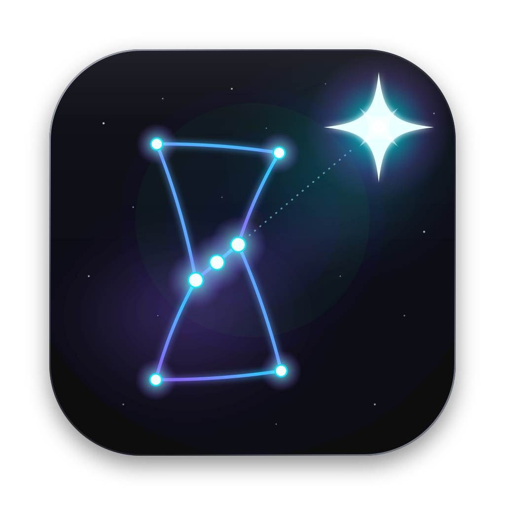

# panel-home · OrionHome



**OrionHome** es el panel de la casa, de la familia de [OrionGit](../client-git) (Santaella): misma constelación de Orión
en reloj de arena, aquí con Sirius como la casa. Al abrirlo, Orión se dibuja mientras llegan los datos; con tema
automático, claro u oscuro (botón ◐), y pensado para usarse también desde el celular.

Una sola web para la casa: cámaras en vivo, mapa de la red, consumo por dispositivo, caídas de internet
y una línea de tiempo de eventos con avisos por Telegram o push. Python 3.9+, sin dependencias.

panel-home no mide nada por sí mismo: une dos proyectos que ya corren en casa.

| Fuente | Qué aporta |
|---|---|
| [NetWatch](../analizadorRed/NetWhatch) (`:8765`) | equipos, caídas de red/internet/DNS, IP pública, latencia |
| [gestorCamaras](../Camaras/gestorCamaras) (`:8080`) | lista y salud de cámaras; el detector guarda fotos de movimiento |
| go2rtc (`:1984`) | el video en vivo que se ve en el panel |

## Uso

```bash
python3 main.py                  # http://127.0.0.1:8770
python3 main.py --host 0.0.0.0   # verlo desde el celular en la misma red
```

Configura copiando `.env.example` a `.env`: `main.py` lo lee solo al arrancar
(las variables que ya estén exportadas en la terminal tienen prioridad).

## Instalación con Docker (Windows o Linux)

Requiere Docker Desktop (en Windows, con WSL 2), igual que gestorCamaras.

```powershell
git clone -b develop https://github.com/jeansacrSantaella/panel-home.git
cd panel-home
copy .env.example .env     # llena el token y chat de Telegram y las URLs con la IP de la red
docker compose up -d --build
```

- En el `.env` usa la IP de la red (`http://192.168.1.94:8765`, `:8080`, `:1984`), nunca `localhost`.
- La base queda en `data/panel.db`; sobrevive a reinicios y a `docker compose up --build`.
- Se levanta sola al iniciar Docker (`restart: unless-stopped`).
- Para verlo desde el celular, permite el puerto **8770** en redes privadas del firewall de Windows y entra a `http://IP_DEL_EQUIPO:8770`.
- Actualizar: `git pull` y `docker compose up -d --build`. Ver la bitácora: `docker logs -f panel-home`.
- Corre una sola copia del panel con Telegram configurado; si hay dos, cada aviso llega dos veces.

## Pestañas

| Pestaña | Qué hay |
|---|---|
| Resumen | todo junto: cámaras, mapa, caídas, consumo y línea de tiempo |
| Capturas | las fotos del detector por día y por cámara |
| Cámaras | el panel de gestorCamaras desde su propia dirección (mover, zoom, agregar cámaras…) |
| Red | NetWatch desde su propia dirección (escáner, alias, eventos…) |

El iframe de Cámaras se cierra al salir de su pestaña para no ocupar una de las sesiones de video (`MAX_SESIONES`).

## Capturas en otra máquina

Si panel-home no corre en la misma máquina que gestorCamaras, pon `FOTOS_REMOTAS=1`: las capturas se piden por HTTP
a `CAMARAS_URL` (`/api/fotos/...`). Requiere la versión de gestorCamaras que expone esas rutas.

## Qué muestra

- **Cámaras:** video en vivo de go2rtc, estado (en vivo / sin video / sin red), latencia, cortes y el último movimiento.
- **Mapa de la red:** el router al centro y cada equipo alrededor; color = calidad, tamaño = consumo. Clic para ver detalle.
- **Caídas:** disponibilidad de 24 h de internet, red local y DNS, caídas por hora del día y latencia de la última hora.
- **Calidad por dispositivo:** latencia y pérdida de cada equipo conectado. Si configuras `CONSUMO_CMD` (ver abajo) pasa a
  **Consumo por dispositivo** con los datos de 24 h. El módem de Telmex (Sercomm FG6122TM) no da bytes por equipo:
  haría falta un router propio con OpenWrt.
- **Almacenamiento de grabaciones:** disco libre y cuánto ocupan fotos y clips (de `GET /api/espacio` de gestorCamaras).
- **Movimiento por día y hora:** mapa de calor de las detecciones de las últimas 4 semanas.
- **Servidor:** CPU, memoria y tiempo encendido del equipo que corre Docker, y el estado de cada contenedor.
  En Windows con Docker Desktop son los datos de la máquina virtual de Docker (WSL 2), no de todo Windows, y la
  temperatura no está disponible. Los contenedores se leen del socket de Docker montado en solo lectura
  (`docker-compose.yml`); si un contenedor se detiene más de ~30 s llega un aviso por Telegram.
- **Línea de tiempo:** movimiento, cámaras caídas, internet caído, cambios de IP, equipos nuevos… con filtros y fotos.

Los gráficos usan `static/js/hchart.js` (y `hchart-calor.js` para el mapa de calor), una librería propia que dibuja solo con HTML y CSS (sin canvas ni SVG).

## Avisos

| Canal | Cómo |
|---|---|
| Telegram | `TELEGRAM_TOKEN` y `TELEGRAM_CHAT_ID` (el mismo bot que NetWatch). Si activas `movimiento` en `PANEL_AVISAR`, llega con foto. |
| Push al celular | instala la app **ntfy**, suscríbete a un tema difícil de adivinar y pon `NTFY_URL=https://ntfy.sh/<tema>`. |
| Navegador | botón *Activar notificaciones* mientras la página está abierta. |

Por defecto panel-home **solo avisa cuando NetWatch o gestorCamaras dejan de responder**. El movimiento no se
avisa al instante (queda en la línea de tiempo; el detector manda un resumen cada 2 h). Las caídas de internet/red/DNS, equipos nuevos y cambios de IP ya los
avisa NetWatch, y las cámaras y go2rtc los avisa gestorCamaras; aquí solo aparecen en la línea de tiempo.
Para cambiarlo usa `PANEL_AVISAR` (lista separada por comas; ver `TIPOS_AVISO` y `YA_AVISADOS` en `panel/config.py`).
Si no hay internet, los avisos esperan y salen al volver; los de más de 24 h se descartan.
En el primer arranque el historial se guarda sin avisar.

## Consumo por dispositivo

Medir cuántos datos usa cada equipo solo se puede desde el router. `CONSUMO_CMD` es cualquier comando que imprima
contadores **acumulados** en JSON, por MAC o IP:

```json
{"aa:bb:cc:dd:ee:ff": {"rx": 123456789, "tx": 9876543}, "192.168.1.50": {"rx": 1000, "tx": 200}}
```

Por ejemplo, en un router OpenWrt con `nlbwmon` o con contadores de iptables, un script por SSH que lea esos
contadores. Sin `CONSUMO_CMD` la tarjeta muestra la calidad de conexión de cada equipo.

## Estructura

```
main.py            arranca recolector, avisos y web
panel/             config, db (SQLite), fuentes, eventos, avisos, web
static/            index.html, css/panel.css, js/hchart.js, js/app.js
docs/              ARQUITECTURA.md (contrato) y BITACORA.md (pasos)
tests/             python3 -m unittest
```

Datos en `panel.db`: eventos 90 días, consumo 30 días.
